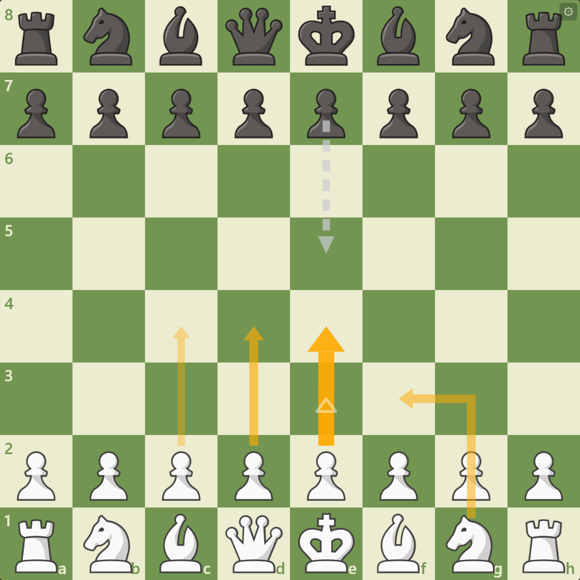
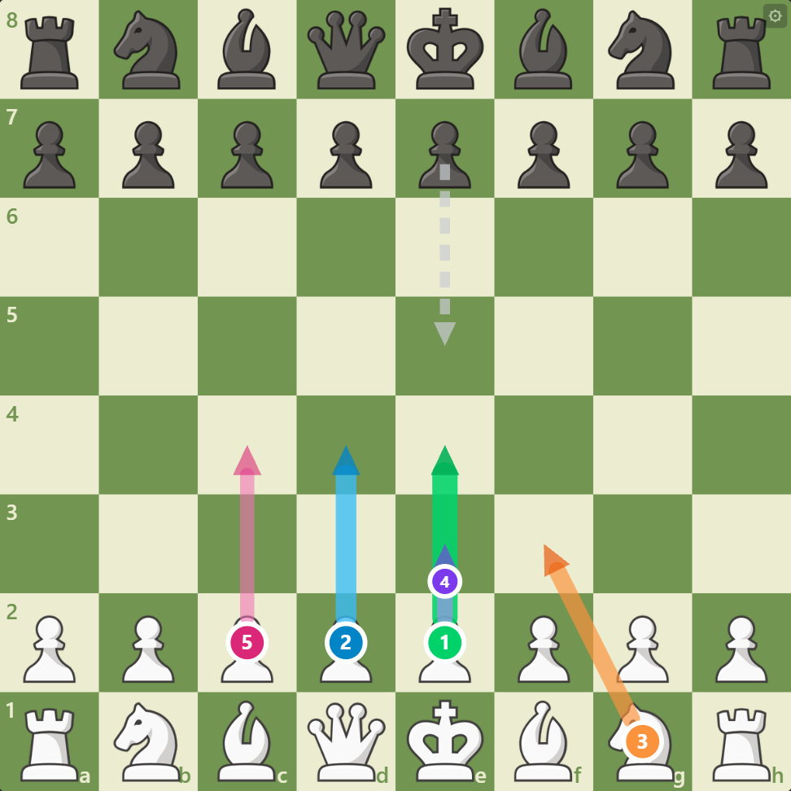
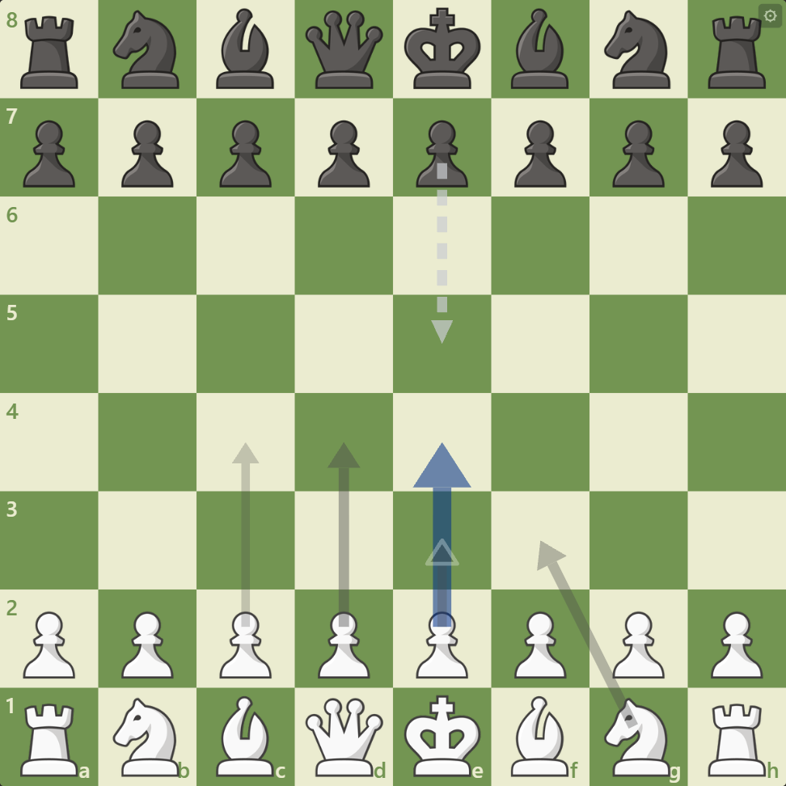

# Chess.com Analysis Arrows

Draws the engine's best moves as arrows on the chess.com board: three by default, up to five, in the style of chess.com's own arrows.

Nothing else to install: when chess.com does not show engine lines, the script starts a second copy of the Stockfish build that chess.com already ships, in a Web Worker inside the page.

> It only works where chess.com itself offers analysis (its **Analysis** switch must be on). It does nothing during your own live games.

## Screenshots

| Watching a game: no moves listed beside the board, so each arrow carries its evaluation | Events broadcast: chess.com lists the engine lines, so the arrows stay clean |
|---|---|
|  |  |

The best move gets the full-size arrow; the others are smaller and more transparent. The evaluation next to each arrow is shown while watching games; on pages where chess.com already lists engine lines beside the board (Events, Analysis) the arrows follow that list and stay clean. Both are checkboxes in the settings.

Three arrow styles, here with five arrows, the expected reply in grey, and the evaluation numbers switched off:

| Like chess.com (default) | Numbered colours | Like Lichess |
|---|---|---|
|  |  |  |

The settings sit at the top of the **Analysis** tab of chess.com's own settings window:

What each control in that block does, from top to bottom:

| Control | What it does |
|---|---|
| **Arrow style** | How the arrows look: like chess.com's own orange arrows (default), numbered colours, or like Lichess (blue and grey). |
| **Arrows** | How many moves are drawn, from 1 to 5. Default 3. |
| **Search time** | The longest the script's engine thinks about one position, from 1 to 30 seconds. Default 8 s. |
| **Max depth** | The script's engine stops when it reaches this depth, or when the search time runs out, whichever comes first. From 10 to 40. Default 18. |
| **Memory** | Memory (hash table) the script's engine may use, from 16 to 512 MB. Default 16 MB. |
| **Hide arrows worse by** | Hides arrows that lose more than this many pawns compared with the best move (0.5 to 3.0). Off by default, shown as `—`. |
| **Evaluation next to the arrows while watching games (Watch)** | Shows the number (for example `+0.36`) at each arrowhead on pages where chess.com shows only the evaluation bar. On by default. |
| **Evaluation next to the arrows where chess.com lists lines (Events, Analysis)** | Shows the same number on pages that already list the engine lines beside the board. Off by default. |
| **Show the expected reply (grey arrow)** | Adds a thin grey dashed arrow with the opponent's expected answer to the best move. Off by default. |
| **Ignore chess.com's lines (own engine only)** | Off: where chess.com lists engine lines, the arrows follow that list and the script's engine only adds the ones chess.com does not list. On: every arrow comes from the script's engine, so its order can differ from chess.com's list. |
| Status line | Where the arrows are coming from right now and, for the script's engine, its current depth. |
| **Reset** | Puts every control above back to its default. |

Changes apply at once and are remembered in the browser; chess.com's **Save** and **Cancel** buttons do not affect them. The three sliders for search time, depth and memory only matter for arrows that come from the script's engine.

## Where it works

| Page | What chess.com shows there |
|---|---|
| Events (broadcasts) | Engine lines |
| Analysis board and Self Analysis | Engine lines |
| Finished games (Analysis tab on the Play page) | Engine lines |
| Games you are watching | Only the evaluation bar |

Where chess.com shows engine lines, the arrows follow them and the script's own Stockfish worker only adds arrows chess.com does not list. Where it shows only the evaluation bar, all arrows come from the script's worker.

## Install

Use one of the two, not both.

### Use

Open a game and turn on chess.com's **Analysis** switch. The arrows appear on the board and follow every move.

### Reading the arrows

- **Best move.** In the default style the arrows look like chess.com's own orange arrows. Only the best move gets the full-size arrow; the others are clearly smaller and more transparent. A knight move is drawn as an L, as chess.com does.
- **How many.** Three arrows by default, up to five.
- **Other styles.** *Numbered colours* gives each move its own colour and a numbered circle (green `1`, blue `2`, orange `3`, purple `4`, pink `5`); if a better arrow leaves the same piece, the number of the weaker one sits on its own shaft. *Like Lichess* draws the best move in blue and the rest in grey.
- **Same line.** When two arrows leave the same square in the same direction, the shorter one is drawn on top with a thin white edge so both stay visible.
- **Expected reply.** Optionally, a thin grey dashed arrow shows the opponent's expected answer to the best move.

### Where the moves and numbers come from

- **Watching a game** (chess.com shows only the evaluation bar): all arrows come from the script's own engine, and each one carries its evaluation, for example `+0.36`. The arrows appear about half a second after the switch is on and keep improving up to the chosen depth.
- **Events, the Analysis page, the Analysis tab of a finished game** (chess.com lists engine lines beside the board): the arrows follow that list, first line first, so the board always agrees with the panel. The numbers are not repeated on the board. If you ask for more arrows than chess.com lists, the script's engine adds the missing ones.
- The evaluation is always from White's side, the convention chess.com uses. While watching, the number comes from the script's engine and the evaluation bar from chess.com's, so the two can differ slightly.
- Next to chess.com's `depth=N` the script shows the depth of its own engine (`arrows d=18`) whenever the arrows come from it.

Each of these defaults has a control in the settings.

### Other behaviour

- **Alt+A** hides or shows the arrows.
- After each move the previous arrows stay faded for an instant until the new analysis arrives, instead of blinking.
- No arrows are drawn on the final position of a finished game; step back and they return.
- While you watch a game, the script remembers whether you left **Analysis** on. chess.com switches it off when another game starts (a rematch, for example) and the script switches it back on. Turn it off yourself and it stays off.
- The arrows stay when you open the Chat tab while watching, even though chess.com hides its Analysis switch there.
## Settings

### Settings panel

The arrow settings live inside chess.com's own settings window. Open it with either of chess.com's gears (the one next to the board, or the one on the Analysis bar) and go to its **Analysis** tab (called **Computer** on the Analysis page): a block with the controls below sits at the top. Changes apply at once, without pressing Save, and are remembered in the browser.

When you are not signed in, chess.com's board gear opens a sign-up prompt instead of its settings, so the script shows a small gear of its own in the top-right corner of the board. Set `ownGearButton: true` in the `CONFIG` block to always show it.

**Arrow style** chooses how the arrows look:

| Like chess.com (default) | Numbered colours | Like Lichess |
|---|---|---|
|  |  |  |
 the two single-colour styles the best move is the strongest arrow and the others get thinner and more transparent; there are no numbered circles.

| Slider | Range | Default | Meaning |
|---|---|---|---|
| Arrows | 1 to 5 | 3 | How many moves are drawn (the engine's `MultiPV`) |
| Search time | 1 to 30 s | 8 s | Longest time the script's engine spends on a position |
| Max depth | 10 to 40 | 18 | The script's engine stops at this depth, or when the search time runs out |
| Memory | 16 to 512 MB | 16 MB | Hash table of the script's engine |
| Hide arrows worse by | off, 0.5 to 3.0 | off | Hides arrows that lose more than this many pawns compared with the best move |

| Checkbox | Default | Meaning |
|---|---|---|
| Ignore chess.com's lines (own engine only) | off | See below |
| Evaluation next to the arrows while watching games (Watch) | on | The number at each arrowhead on pages where chess.com shows only the evaluation bar |
| Evaluation next to the arrows where chess.com lists lines (Events, Analysis) | off | The same number on pages that already list engine lines beside the board |
| Show the expected reply | off | A thin grey dashed arrow with the opponent's expected answer to the best move |

Where chess.com lists engine lines (Events, the Analysis page), the arrows follow that list: its first line is arrow 1, its second arrow 2, and so on, so the board always agrees with the panel next to it. If you ask for more arrows than chess.com lists (its own "Engine Lines" setting is usually 3), the script's engine adds the missing ones. With **Ignore chess.com's lines** on, every arrow comes from the script's engine instead, as on the Watch tab; its ranking can then differ from chess.com's panel, because the two engines search to different depths. Lines written with another language's piece letters (Spanish `Ce7`, German `Se7`) are understood. There is no threads slider: chess.com's game pages are not cross-origin isolated, so the browser only allows the single-threaded engine there.

### `CONFIG` block

The remaining options are at the top of the script.

| Option | Default | Meaning |
|---|---|---|
| `fallbackEngine` | `true` | Set to `false` to only read the lines chess.com shows |
| `keepAnalysisOnWhileWatching` | `true` | Switch chess.com's Analysis back on when it resets it while you are watching |
| `multiPv`, `maxTimeMs`, `maxDepth`, `hashMb`, `hideWorseBy` | `3`, `8000`, `18`, `16`, `0` | Starting values for the sliders above |
| `arrowStyle`, `scoresWatch`, `scoresWithLines`, `showReply`, `ownEngineOnly` | `'chesscom'`, `true`, `false`, `false`, `false` | Starting values for the style selector and the checkboxes |
| `hideAtGameEnd` | `true` | No arrows on the final position of a finished game |
| `hotkey` | `'a'` | Alt + this key hides or shows the arrows; `''` disables it |
| `showDepthTag` | `true` | Show the script engine's depth next to chess.com's `depth=N` |
| `ownGearButton` | `false` | Always show the script's own gear on the board |
| `minDepthToDraw` | `8` | No arrows are drawn below this depth, so they do not jump around |
| `graceEngineSeenMs` | `100` | Wait once chess.com's own engine is running and the page has no lines panel |
| `graceNoPanelMs` | `1000` | Longest wait before starting the engine when the page has no lines panel |
| `graceEmptyPanelMs` | `3000` | Wait when the lines panel exists but is empty |
| `engineBootTimeoutsMs` | `[2500, 6000, 12000]` | How long to wait for the worker to answer on each attempt before trying the next engine |
| `engineIdleKillMs` | `60000` | The worker is shut down after this long without use |
| `debug` | `false` | Detailed messages in the console |

## How it works

- **chess.com shows lines.** The script reads the first move of each line from the page (`wc-evaluation-lines` or `.engine-line-component`) and turns it into squares using the board's own list of legal moves.
- **chess.com shows no lines.** The script takes the exact position from the board (`wc-chess-board.game.getFEN()`), finds the Stockfish worker URL in `window.chesscom.featuresConfig`, and runs it with the `MultiPV` and hash size chosen in the settings panel. chess.com's own engine and evaluation bar are left alone.
- **Fallbacks.** Without the board API, the position is rebuilt from the page. If chess.com's engine cannot be found, the script loads stockfish.js 10.0.2 from cdnjs, checked against a fixed integrity hash. That engine is much slower.

## Fair play

The script's engine starts only when chess.com's Analysis switch exists and is on, and never while the board is in `playing` mode. chess.com does not offer that switch during your own live games, so the script stays idle there. The script only ever turns that switch back on while the board is in `observing` mode.

Using engine help in your own games breaks chess.com's Fair Play policy. This tool is for studying, following broadcasts and watching other people's games.

## Troubleshooting

Open the browser console on chess.com:

- `[Top3 Arrows] v9.6.4 cargado.` confirms the script is running.
- `__top3ArrowsHybrid.status()` shows where the arrows come from (`dom`, `engine`, `none` or `off`) and the engine's state.
- If the arrows are slow to appear, `status().timeline` tells which stage took the time. It gives the milliseconds from the start of the page load to each step: `script`, `board`, `analysisOn`, `engineBoot`, `engineReady` and `arrows`.
- Double arrows mean two copies are active, for example the userscript and the extension, or an older version of the script.

## Disclaimer

This project is not affiliated with Chess.com. It depends on undocumented parts of the site and may stop working when chess.com changes them.
