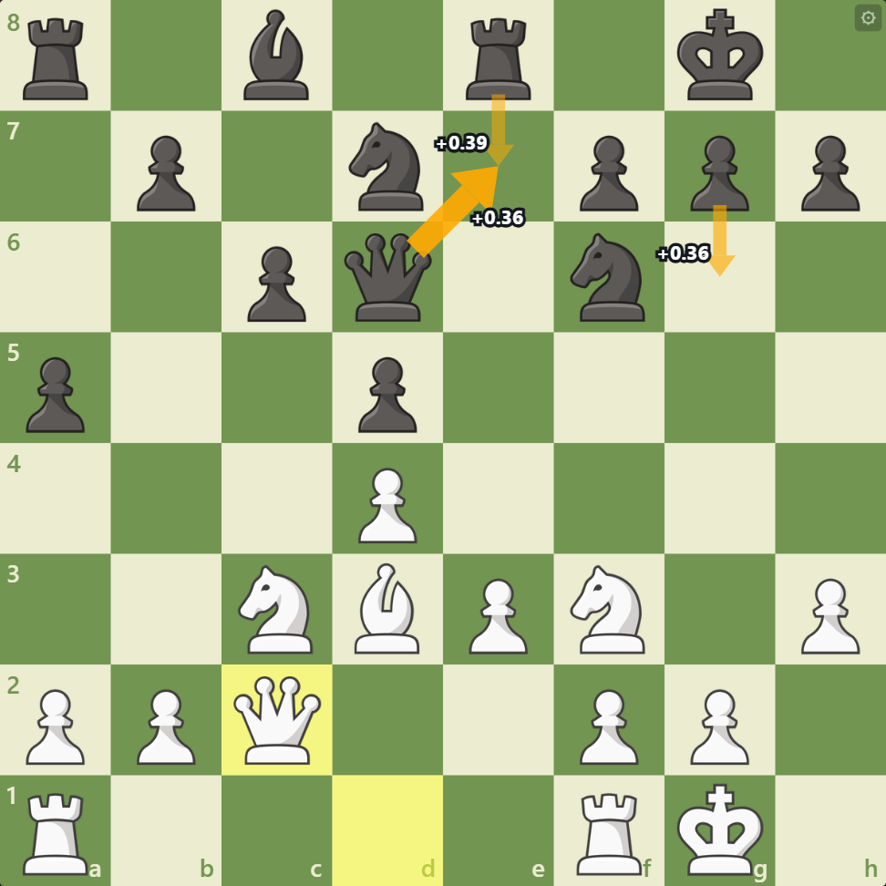
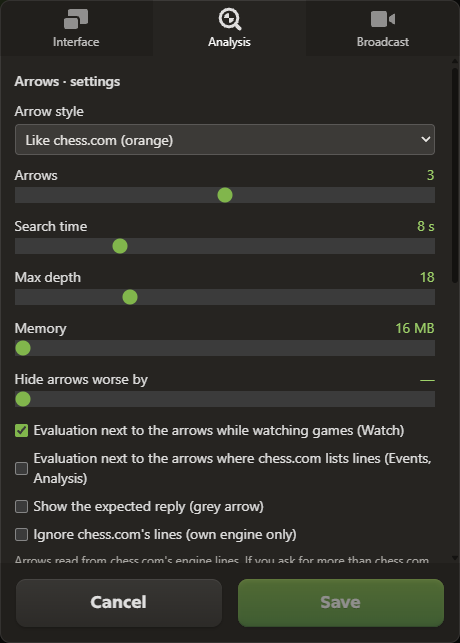

# Chess.com Analysis Arrows

Draws the engine's best moves as arrows on the chess.com board: three by default, up to five, in the style of chess.com's own arrows.

Nothing else to install: when chess.com does not show engine lines, the script starts a second copy of the Stockfish build that chess.com already ships, in a Web Worker inside the page. If that build is not available, it falls back to Stockfish 19 (bundled in the Firefox add-on, downloaded and checked by hash in the userscript).

Available as a Firefox add-on, a userscript (Tampermonkey, Violentmonkey) and an unpacked Chrome extension: see [Install](#install).

> It only works where chess.com itself offers analysis (its **Analysis** switch must be on). It does nothing during your own live games.

## Install

Pick **one** of the three. If two copies are active at once (for example the userscript and the extension), the second one notices the first and stays off.

| | Best for | Updates |
|---|---|---|
| [Firefox add-on](#firefox) | Firefox 140 or later | Automatic once it is on Firefox Add-ons; manual from a zip |
| [Userscript](#userscript-tampermonkey-or-violentmonkey) | Any browser with Tampermonkey or Violentmonkey | Automatic |
| [Chrome extension](#chrome-edge-brave-opera) | Chrome, Edge, Brave, Opera without a userscript manager | Manual |

### Firefox

The Firefox add-on carries its own copy of Stockfish 19, so it works even if chess.com stops shipping its engine. It downloads nothing from other sites.

**From Firefox Add-ons (once the listing is published):** open the add-on's page on [addons.mozilla.org](https://addons.mozilla.org/), click **Add to Firefox** and accept. Firefox keeps it up to date.

**From the zip:**

1. Download `chesscom-arrows-firefox-<version>.zip` from the [Releases](https://github.com/hediondom/Chess.com-Arrows/releases) page. Do not unzip it.
2. Open `about:debugging#/runtime/this-firefox` in the address bar.
3. Click **Load Temporary Add-on…** and choose the zip.
4. Reload chess.com.

Firefox removes temporary add-ons when it closes, so this way is best for trying the add-on. To update, load the newer zip the same way.

### Userscript (Tampermonkey or Violentmonkey)

1. Install a userscript manager: [Tampermonkey](https://www.tampermonkey.net/) (Chrome, Edge, Firefox, Safari, Opera) or [Violentmonkey](https://violentmonkey.github.io/) (Chrome, Edge, Firefox).
2. In Chrome and Edge, allow the manager to run userscripts: open `chrome://extensions`, open the manager's **Details** and turn on **Allow user scripts** (on older versions, turn on **Developer mode** at the top right of `chrome://extensions` instead).
3. Open [the script](https://github.com/hediondom/Chess.com-Arrows/raw/main/chess_analysis_arrows.user.js). The manager shows an install page; click **Install**.
4. Reload chess.com.

The manager checks for new versions on its own. If chess.com cannot provide its engine, the userscript downloads Stockfish 19 from unpkg (and as a last resort stockfish.js 10 from cdnjs), each file pinned to an exact version and checked by hash before it runs.

### Chrome, Edge, Brave, Opera

1. On this page click the green **Code** button → **Download ZIP**, and unzip it.
2. Open `chrome://extensions` (`edge://extensions` in Edge).
3. Turn on **Developer mode** (top right in Chrome, left panel in Edge).
4. Click **Load unpacked** and choose the `chrome-extension` folder from the unzipped files.
5. Reload chess.com.

To update, download the ZIP again, replace the folder and press the reload icon on the extension's card. The extension only asks for access to `https://www.chess.com/*`.

### Check that it works

1. Open [chess.com/analysis](https://www.chess.com/analysis), or any game, and turn on chess.com's **Analysis** switch.
2. The arrows appear on the board and follow every move.
3. Optional: in the browser console (F12 → **Console**) you should see `[Top3 Arrows] v9.8.0 cargado.`

The settings are at the top of the **Analysis** tab of chess.com's own settings window (the gear next to the board). See [Settings](#settings).

### Uninstall

- Firefox: `about:addons` → the add-on's **…** menu → **Remove**.
- Userscript: open the manager's dashboard and delete *Chess.com - Top 3 Analysis Arrows*.
- Chrome and similar: `chrome://extensions` → **Remove** on the extension's card.

The settings are stored in chess.com's local storage under `top3arrows_settings`; clearing chess.com's site data removes them.

## What's new in 9.8.0

- **Follow chess.com's depth** (new, on by default): while you watch a game, the arrows' engine now searches as deep as chess.com's own engine (the `depth=N` next to the Analysis switch) instead of stopping at depth 18 or after 8 s. It stops when chess.com stops going deeper and resumes if chess.com goes deeper later; limits are depth 40 and 60 s per position. It uses more CPU; turn it off in the settings to go back to **Max depth** and **Search time**.

## What's new in 9.7.0

**Fair play and security**

- The script's own engine now fails closed: it only runs when the board is in a known analysis or watching mode (`analysis`, `observing`, `review`). If chess.com's board API is missing or its mode cannot be read, the engine stays off. The diagnostic log records why it was held back.
- Only chess.com's real Analysis switch counts; any other toggle on the page no longer does.
- The extension asks only for `https://www.chess.com/*` (the unused `activeTab` and `file:///*` permissions are gone).
- The console object `__top3ArrowsHybrid` is read-only, so the page cannot change the settings through it.

**Engine**

- Fallback engine upgraded from stockfish.js 10 to **Stockfish 19 lite**. The userscript downloads it from unpkg, checked by hash; the Firefox add-on carries it inside and downloads nothing.
- `__top3ArrowsHybrid.testReserveEngine()` switches to the fallback engines to try them.

**New settings**

- **Arrow width follows the evaluation**: weaker moves get thinner arrows, as on Lichess (off by default).
- **Show the line when the mouse is on an arrow's target square**: the rest of that line appears as thin numbered arrows (off by default).

**Fixes**

- **Alt+A** works on a Mac (**Option+A**) and on keyboard layouts where that combination types another character.
- **Hide arrows worse by** and **Show the expected reply** now also work on Events and the Analysis page, not only while watching.
- The side to move comes from the position, not from the text of chess.com's line, so Black's moves are no longer misread when the board API is missing.

**Under the hood**

- The code is split into modules in `src/`; one build writes the userscript and the extension's `content.js`, which are identical.
- Unit tests (SAN, FEN, engine output, fair-play checks) and a smoke test of the built script.
- Every chess.com selector is in one file, and the console says what is missing if chess.com changes its page.
- The settings block sits in a Shadow DOM, so chess.com's styles do not affect it.
- Lighter on the page: the observers watch only the board and the lines panel, the safety check runs every 2 s instead of 0.5 s when nothing is being analysed, and evaluation numbers update without redrawing the arrows.
- New: extension icons, English and Spanish names, and a Firefox build for Firefox Add-ons.

## Screenshots

| Watching a game: no moves listed beside the board, so each arrow carries its evaluation | Events broadcast: chess.com lists the engine lines, so the arrows stay clean |
|---|---|
|  |  |

The best move gets the full-size arrow; the others are smaller and more transparent. The evaluation next to each arrow is shown while watching games; on pages where chess.com already lists engine lines beside the board (Events, Analysis) the arrows follow that list and stay clean. Both are checkboxes in the settings.

Three arrow styles, here with five arrows, the expected reply in grey, and the evaluation numbers switched off:

| Like chess.com (default) | Numbered colours | Like Lichess |
|---|---|---|
|  |  |  |

The settings sit at the top of the **Analysis** tab of chess.com's own settings window:



What each control in that block does, from top to bottom:

| Control | What it does |
|---|---|
| **Arrow style** | How the arrows look: like chess.com's own orange arrows (default), numbered colours, or like Lichess (blue and grey). |
| **Arrows** | How many moves are drawn, from 1 to 5. Default 3. |
| **Search time** | The longest the script's engine thinks about one position, from 1 to 30 seconds. Default 8 s. Not used while **Follow chess.com's depth** is on. |
| **Max depth** | The script's engine stops when it reaches this depth, or when the search time runs out, whichever comes first. From 10 to 40. Default 18. Not used while **Follow chess.com's depth** is on, unless chess.com shows no depth. |
| **Memory** | Memory (hash table) the script's engine may use, from 16 to 512 MB. Default 16 MB. |
| **Hide arrows worse by** | Hides arrows that lose more than this many pawns compared with the best move (0.5 to 3.0). Off by default, shown as `—`. |
| **Evaluation next to the arrows while watching games (Watch)** | Shows the number (for example `+0.36`) at each arrowhead on pages where chess.com shows only the evaluation bar. On by default. |
| **Evaluation next to the arrows where chess.com lists lines (Events, Analysis)** | Shows the same number on pages that already list the engine lines beside the board. Off by default. |
| **Show the expected reply (grey arrow)** | Adds a thin grey dashed arrow with the opponent's expected answer to the best move. Off by default. |
| **Ignore chess.com's lines (own engine only)** | Off: where chess.com lists engine lines, the arrows follow that list and the script's engine only adds the ones chess.com does not list. On: every arrow comes from the script's engine, so its order can differ from chess.com's list. |
| **Arrow width follows the evaluation** | The more a move loses compared with the best one, the thinner its arrow, as on Lichess. Off by default. |
| **Show the line when the mouse is on an arrow's target square** | Point at the square an arrow lands on and the rest of that line appears as thin numbered arrows. Only for arrows from the script's engine. Off by default. |
| **Follow chess.com's depth** | The script's engine keeps searching until it reaches the depth chess.com shows (`depth=N`), instead of stopping at **Max depth** or **Search time**. It stops once chess.com stops going deeper, and resumes if chess.com goes deeper later. Limits: depth 40, 60 s per position. Uses more CPU. On by default. |
| Status line | Where the arrows are coming from right now and, for the script's engine, its current depth. |
| **Reset** | Puts every control above back to its default. |

Changes apply at once and are remembered in the browser; chess.com's **Save** and **Cancel** buttons do not affect them. The three sliders for search time, depth and memory only matter for arrows that come from the script's engine.

## Where it works

| Page | What chess.com shows there |
|---|---|
| Events (broadcasts) | Engine lines |
| Analysis board and Self Analysis | Engine lines |
| Finished games (Analysis tab on the Play page) | Engine lines |
| Games you are watching | Only the evaluation bar |

Where chess.com shows engine lines, the arrows follow them and the script's own Stockfish worker only adds arrows chess.com does not list. Where it shows only the evaluation bar, all arrows come from the script's worker.

## Reading the arrows

- **Best move.** In the default style the arrows look like chess.com's own orange arrows. Only the best move gets the full-size arrow; the others are clearly smaller and more transparent. A knight move is drawn as an L, as chess.com does.
- **How many.** Three arrows by default, up to five.
- **Other styles.** *Numbered colours* gives each move its own colour and a numbered circle (green `1`, blue `2`, orange `3`, purple `4`, pink `5`); if a better arrow leaves the same piece, the number of the weaker one sits on its own shaft. *Like Lichess* draws the best move in blue and the rest in grey.
- **Same line.** When two arrows leave the same square in the same direction, the shorter one is drawn on top with a thin white edge so both stay visible.
- **Expected reply.** Optionally, a thin grey dashed arrow shows the opponent's expected answer to the best move.

### Where the moves and numbers come from

- **Watching a game** (chess.com shows only the evaluation bar): all arrows come from the script's own engine, and each one carries its evaluation, for example `+0.36`. The arrows appear about half a second after the switch is on and keep improving up to the chosen depth.
- **Events, the Analysis page, the Analysis tab of a finished game** (chess.com lists engine lines beside the board): the arrows follow that list, first line first, so the board always agrees with the panel. The numbers are not repeated on the board. If you ask for more arrows than chess.com lists, the script's engine adds the missing ones.
- The evaluation is always from White's side, the convention chess.com uses. While watching, the number comes from the script's engine and the evaluation bar from chess.com's, so the two can differ slightly.
- Next to chess.com's `depth=N` the script shows the depth of its own engine (`arrows d=18`) whenever the arrows come from it. They are two separate engines. With **Follow chess.com's depth** (on by default) the script's engine goes as deep as chess.com's; it may end one level deeper, because it finishes the level it is on. Turn it off and the script's engine stops at **Max depth** (18) or after **Search time** (8 s), whichever comes first.

Each of these defaults has a control in the settings.

### Other behaviour

- **Alt+A** (**Option+A** on a Mac) hides or shows the arrows. It uses the physical key, so it also works on keyboard layouts where that combination types another character.
- After each move the previous arrows stay faded for an instant until the new analysis arrives, instead of blinking.
- No arrows are drawn on the final position of a finished game; step back and they return.
- While you watch a game, the script remembers whether you left **Analysis** on. chess.com switches it off when another game starts (a rematch, for example) and the script switches it back on. Turn it off yourself and it stays off.
- The arrows stay when you open the Chat tab while watching, even though chess.com hides its Analysis switch there.

## Settings

### Settings panel

The arrow settings live inside chess.com's own settings window. Open it with either of chess.com's gears (the one next to the board, or the one on the Analysis bar) and go to its **Analysis** tab (called **Computer** on the Analysis page): a block with the controls below sits at the top. Changes apply at once, without pressing Save, and are remembered in the browser.

When you are not signed in, chess.com's board gear opens a sign-up prompt instead of its settings, so the script shows a small gear of its own in the top-right corner of the board. Set `ownGearButton: true` in the `CONFIG` block to always show it.

**Arrow style** chooses how the arrows look: like chess.com's own orange arrows (default), numbered colours, or like Lichess. The three are shown side by side in [Screenshots](#screenshots). In the two single-colour styles only the best move gets the full-size arrow and the others are smaller and more transparent; there are no numbered circles.

| Slider | Range | Default | Meaning |
|---|---|---|---|
| Arrows | 1 to 5 | 3 | How many moves are drawn (the engine's `MultiPV`) |
| Search time | 1 to 30 s | 8 s | Longest time the script's engine spends on a position |
| Max depth | 10 to 40 | 18 | The script's engine stops at this depth, or when the search time runs out |
| Memory | 16 to 512 MB | 16 MB | Hash table of the script's engine |
| Hide arrows worse by | off, 0.5 to 3.0 | off | Hides arrows that lose more than this many pawns compared with the best move |

| Checkbox | Default | Meaning |
|---|---|---|
| Ignore chess.com's lines (own engine only) | off | See below |
| Evaluation next to the arrows while watching games (Watch) | on | The number at each arrowhead on pages where chess.com shows only the evaluation bar |
| Evaluation next to the arrows where chess.com lists lines (Events, Analysis) | off | The same number on pages that already list engine lines beside the board |
| Show the expected reply | off | A thin grey dashed arrow with the opponent's expected answer to the best move. Where chess.com lists lines, it is shown once the script's engine agrees with chess.com's best move |
| Arrow width follows the evaluation | off | Arrows that lose more against the best move are thinner |
| Show the line when the mouse is on an arrow's target square | off | The rest of that line, as thin numbered arrows (script's engine only) |
| Follow chess.com's depth | on | The script's engine searches as deep as chess.com's engine (`depth=N` next to the switch) and ignores Max depth and Search time; up to depth 40 or 60 s per position |

**Hide arrows worse by** works on every page: it compares chess.com's own numbers where it lists lines, and the script engine's numbers elsewhere.

Where chess.com lists engine lines (Events, the Analysis page), the arrows follow that list: its first line is arrow 1, its second arrow 2, and so on, so the board always agrees with the panel next to it. If you ask for more arrows than chess.com lists (its own "Engine Lines" setting is usually 3), the script's engine adds the missing ones. With **Ignore chess.com's lines** on, every arrow comes from the script's engine instead, as on the Watch tab; its ranking can then differ from chess.com's panel, because the two engines search to different depths. Lines written with another language's piece letters (Spanish `Ce7`, German `Se7`) are understood. There is no threads slider: chess.com's game pages are not cross-origin isolated, so the browser only allows the single-threaded engine there.

### `CONFIG` block

The remaining options are in [`src/config.js`](src/config.js) (run `npm run build` after changing them; see [Development](#development)).

| Option | Default | Meaning |
|---|---|---|
| `fallbackEngine` | `true` | Set to `false` to only read the lines chess.com shows |
| `fairPlayModes` | `['analysis', 'observing', 'review']` | Board modes in which the script's engine may run. Any other mode, or a mode that cannot be read, keeps it off |
| `keepAnalysisOnWhileWatching` | `true` | Switch chess.com's Analysis back on when it resets it while you are watching |
| `multiPv`, `maxTimeMs`, `maxDepth`, `hashMb`, `hideWorseBy` | `3`, `8000`, `18`, `16`, `0` | Starting values for the sliders above |
| `arrowStyle`, `scoresWatch`, `scoresWithLines`, `showReply`, `ownEngineOnly`, `widthByEval`, `pvOnHover`, `followChessComDepth` | `'chesscom'`, `true`, `false`, `false`, `false`, `false`, `false`, `true` | Starting values for the style selector and the checkboxes |
| `hideAtGameEnd` | `true` | No arrows on the final position of a finished game |
| `hotkey` | `'a'` | Alt + this key hides or shows the arrows; `''` disables it |
| `showDepthTag` | `true` | Show the script engine's depth next to chess.com's `depth=N` |
| `ownGearButton` | `false` | Always show the script's own gear on the board |
| `minDepthToDraw` | `8` | No arrows are drawn below this depth, so they do not jump around |
| `graceEngineSeenMs` | `100` | Wait once chess.com's own engine is running and the page has no lines panel |
| `graceNoPanelMs` | `1000` | Longest wait before starting the engine when the page has no lines panel |
| `graceEmptyPanelMs` | `3000` | Wait when the lines panel exists but is empty |
| `engineBootTimeoutsMs` | `[2500, 6000, 12000]` | How long to wait for the worker to answer on each attempt before trying the next engine |
| `engineStopTimeoutMs` | `700` | If the engine does not drop the previous search within this time, its worker is restarted (a restart takes about 0.2 s) |
| `engineSilenceMs` | `1500` | If the engine says nothing for this long after being asked for an analysis, its worker is restarted |
| `engineIdleKillMs` | `60000` | The worker is shut down after this long without use |
| `debug` | `false` | Detailed messages in the console |

## How it works

- **chess.com shows lines.** The script reads the first move of each line from the page (`wc-evaluation-lines` or `.engine-line-component`) and turns it into squares using the board's own list of legal moves.
- **chess.com shows no lines.** The script takes the exact position from the board (`wc-chess-board.game.getFEN()`), finds the Stockfish worker URL in `window.chesscom.featuresConfig`, and runs it with the `MultiPV` and hash size chosen in the settings panel. chess.com's own engine and evaluation bar are left alone.
- **Fallbacks.** Without the board API, the position is rebuilt from the page. If chess.com's engine cannot be found:
  - the **Firefox add-on** uses the **Stockfish 19 lite** it carries inside (single-threaded WASM, about 1.9 MB). It downloads nothing;
  - the **userscript** and the unpacked Chrome extension download that same Stockfish 19 lite from unpkg, and if that fails, stockfish.js 10.0.2 from cdnjs.

  Every engine file is pinned to an exact version and checked against a fixed integrity hash (SRI) before it runs. `__top3ArrowsHybrid.testReserveEngine()` switches to these engines to try them.
- **When chess.com changes its page.** Every selector the script uses is in [`src/selectors.js`](src/selectors.js). If the board or its API is missing, the console says what was not found.

## Fair play

The script's engine starts only when all of these hold:

- chess.com's Analysis switch exists and is on;
- the board exposes its game API and its mode is one of `fairPlayModes` (`analysis`, `observing`, `review`). `playing`, any unknown mode, or a mode that cannot be read keeps the engine off (it fails closed);
- the game is standard chess.

chess.com does not offer the Analysis switch during your own live games, so the script stays idle there. The script only ever turns that switch back on while the board is in `observing` mode. When the engine is held back, `__top3ArrowsHybrid.log()` records why (`engineBlocked reason=…`).

Using engine help in your own games breaks chess.com's Fair Play policy. This tool is for studying, following broadcasts and watching other people's games.

## Troubleshooting

Open the browser console on chess.com:

- `[Top3 Arrows] v9.8.0 cargado.` confirms the script is running.
- `__top3ArrowsHybrid.config()` returns a copy of the current settings (the console object is read-only, so the page cannot change them through it).
- `__top3ArrowsHybrid.status()` shows where the arrows come from (`dom`, `engine`, `none` or `off`) and the engine's state.
- If the arrows are slow to appear, `status().timeline` tells which stage took the time. It gives the milliseconds from the start of the page load to each step: `script`, `board`, `analysisOn`, `engineBoot`, `engineReady` and `arrows`.
- Double arrows mean two copies are active, for example the userscript and the extension, or an older version of the script.

- `__top3ArrowsHybrid.log()` in the console prints a timed record of what the script saw and did: game changes, the board mode, the Analysis switch, automatic clicks, engine restarts and when arrows were drawn. It survives a page reload. Paste it when reporting a delay; `__top3ArrowsHybrid.clearLog()` empties it.

## Development

The code lives in [`src/`](src/) as ES modules. `chess_analysis_arrows.user.js` and `chrome-extension/content.js` are generated from it, so do not edit them by hand.

```bash
npm install
npm test        # unit tests (SAN, FEN, UCI parsing, fair-play checks) and a smoke test of the built bundle
npm run build   # writes the userscript and the extension's content.js; the version comes from package.json
npm run icons   # redraws the extension icons
npm run package:firefox  # the two zips for addons.mozilla.org, in dist/
npm run lint:firefox     # Mozilla's add-on linter on dist/firefox
```

**Firefox add-on (AMO).** `npm run package:firefox` writes:

- `dist/chesscom-arrows-firefox-<version>.zip`: the add-on to upload. It is a store build: no code is downloaded from outside the package. `content.js` keeps only chess.com's engine and the bundled Stockfish 19 lite (`engine/`, from the npm package `stockfish@19.0.1`, unmodified and checked by hash; GPLv3, see `engine/Copying.txt` and `THIRD_PARTY_NOTICES.txt`). A small `bridge.js` tells the page script where `engine/` is.
- `dist/chesscom-arrows-source-<version>.zip`: the source code with `BUILD.md`, which AMO asks for because `content.js` is built with esbuild.
- `dist/firefox/`: the same add-on unzipped, for `about:debugging` and the linter.

The add-on ID in `scripts/package-firefox.mjs` must never change once published: Firefox uses it for updates.

| Module | What it does |
|---|---|
| `config.js` | Options, settings storage, pinned CDN engines |
| `selectors.js` | Every chess.com selector, and the self-check |
| `san.js`, `fen.js`, `uci.js` | Pure functions: SAN to squares, FEN, engine output |
| `board.js` | Reading the board and chess.com's engine lines |
| `fairplay.js` | When the script's engine may run; keeping Analysis on while watching |
| `engine.js` | The Stockfish worker |
| `draw.js` | The SVG arrows |
| `ui.js`, `i18n.js` | The settings block (in a Shadow DOM) and its texts |
| `main.js` | The update loop and the observers |

To add a language to the settings block, add an entry to `src/i18n.js`. The extension's name and description are in `chrome-extension/_locales/`.

## Disclaimer

This project is not affiliated with Chess.com. It depends on undocumented parts of the site and may stop working when chess.com changes them.
