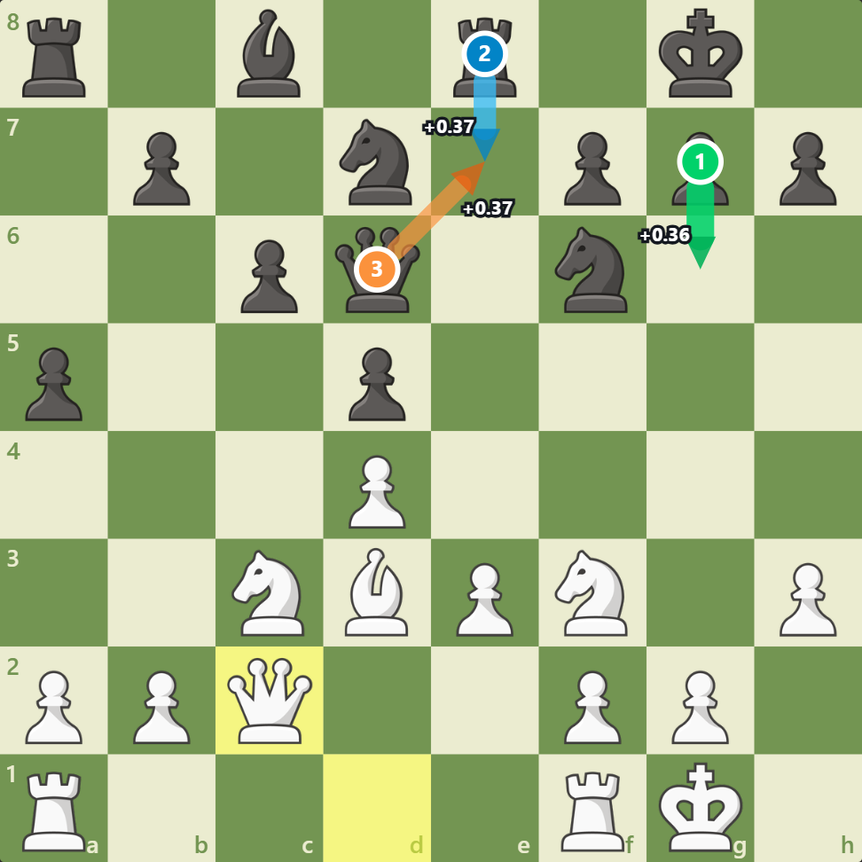
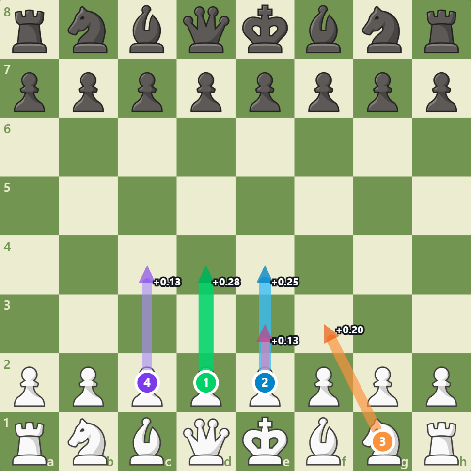
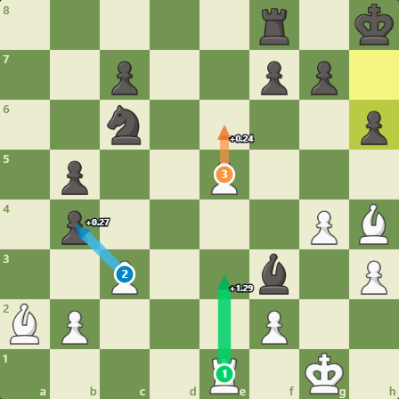

# Chess.com Top-3 Analysis Arrows

Draws the engine's three best moves as arrows on the chess.com board, each with its rank and evaluation.

Nothing else to install: when chess.com does not show engine lines, the script starts a second copy of the Stockfish build that chess.com already ships, in a Web Worker inside the page.

> It only works where chess.com itself offers analysis (its **Analysis** switch must be on). It does nothing during your own live games.

## Screenshots

| Default: the three best moves | Up to five arrows |
|---|---|
|  |  |

When two arrows leave the same square along the same line, the shorter one is drawn on top so both stay visible (pink `e3` over blue `e4` above).

The settings sit at the top of the **Analysis** tab of chess.com's own settings window:

On an Events broadcast:

## Where it works

| Page | What chess.com shows there |
|---|---|
| Events (broadcasts) | Engine lines |
| Analysis board and Self Analysis | Engine lines |
| Finished games (Analysis tab on the Play page) | Engine lines |
| Games you are watching | Only the evaluation bar |

By default the arrows come from the script's own Stockfish worker on all of them, so the same settings apply everywhere. Where chess.com shows engine lines, those are drawn for the instant the worker needs to reach a usable depth, and you can switch to using them all the time (see **Settings**).

## Install

Use one of the two, not both.

### Userscript

1. Install [Tampermonkey](https://www.tampermonkey.net/) or [Violentmonkey](https://violentmonkey.github.io/).
2. Open [`chess_analysis_arrows.user.js`](https://github.com/hediondom/Chess.com-Arrows/raw/main/chess_analysis_arrows.user.js) and confirm the install.
3. Remove any older copy of the script from the userscript manager, or only the first one loaded will run.

The script must keep `@grant none`: it has to run in the page itself to reach the board and the engine.

### Chrome or Edge extension

1. Download this repository.
2. Open `chrome://extensions` and turn on **Developer mode**.
3. Choose **Load unpacked** and select the `chrome-extension` folder.

`chrome-extension/content.js` is a copy of the userscript. The manifest runs it with `"world": "MAIN"`, which needs Chrome 111 or later.

## Use

Open a game and turn on chess.com's **Analysis** switch.

- Green `1` is the best move, blue `2` the second, orange `3` the third. With more arrows enabled, `4` is purple and `5` is pink.
- The number next to each arrowhead is the evaluation from White's side, the same convention chess.com uses.
- On pages without engine lines, the arrows appear about half a second after the switch is turned on and keep improving up to depth 18.
- While you watch a game, the script remembers whether you left **Analysis** on. chess.com switches it off when another game starts (a rematch, for example) and the script switches it back on. Turn it off yourself and it stays off.

## Settings

### Settings panel

The arrow settings live inside chess.com's own settings window. Open it with either of chess.com's gears (the one next to the board, or the one on the Analysis bar) and go to its **Analysis** tab (called **Computer** on the Analysis page): a block with four sliders sits at the top. Changes apply at once, without pressing Save, and are remembered in the browser.

If chess.com ever changes that window and the block stops appearing, set `ownGearButton: true` in the `CONFIG` block to get a small gear of the script's own in the top-right corner of the board.

| Slider | Range | Default | Meaning |
|---|---|---|---|
| Arrows | 1 to 5 | 3 | How many moves are drawn (the engine's `MultiPV`) |
| Search time | 1 to 30 s | 8 s | Longest time the script's engine spends on a position |
| Max depth | 10 to 40 | 18 | The script's engine stops at this depth, or when the search time runs out |
| Memory | 16 to 512 MB | 16 MB | Hash table of the script's engine |

The panel also has a checkbox, **Always use own engine** (on by default). With it on, every arrow comes from the script's engine on all pages, exactly as on the Watch tab, so the sliders apply everywhere; chess.com's own lines are only drawn for the instant the engine needs to reach a usable depth. With it off, pages where chess.com shows engine lines use those lines, and if you ask for more arrows than chess.com lists (its own "Engine Lines" setting is usually 3), the script's engine works out the missing ones. Lines written with another language's piece letters (Spanish `Ce7`, German `Se7`) are understood. There is no threads slider: chess.com's game pages are not cross-origin isolated, so the browser only allows the single-threaded engine there.

### `CONFIG` block

The remaining options are at the top of the script.

| Option | Default | Meaning |
|---|---|---|
| `fallbackEngine` | `true` | Set to `false` to only read the lines chess.com shows |
| `keepAnalysisOnWhileWatching` | `true` | Switch chess.com's Analysis back on when it resets it while you are watching |
| `multiPv`, `maxTimeMs`, `maxDepth`, `hashMb` | `3`, `8000`, `18`, `16` | Starting values for the four sliders above |
| `minDepthToDraw` | `8` | No arrows are drawn below this depth, so they do not jump around |
| `graceEngineSeenMs` | `100` | Wait once chess.com's own engine is running and the page has no lines panel |
| `graceNoPanelMs` | `1000` | Longest wait before starting the engine when the page has no lines panel |
| `graceEmptyPanelMs` | `3000` | Wait when the lines panel exists but is empty |
| `engineBootTimeoutsMs` | `[2500, 6000, 12000]` | How long to wait for the worker to answer on each attempt before trying the next engine |
| `engineIdleKillMs` | `60000` | The worker is shut down after this long without use |
| `debug` | `false` | Detailed messages in the console |

## How it works

- **chess.com shows lines.** The script reads the first move of each line from the page (`wc-evaluation-lines` or `.engine-line-component`) and turns it into squares using the board's own list of legal moves.
- **chess.com shows no lines.** The script takes the exact position from the board (`wc-chess-board.game.getFEN()`), finds the Stockfish worker URL in `window.chesscom.featuresConfig`, and runs it with the `MultiPV` and hash size chosen in the settings panel. chess.com's own engine and evaluation bar are left alone.
- **Fallbacks.** Without the board API, the position is rebuilt from the page. If chess.com's engine cannot be found, the script loads stockfish.js 10.0.2 from cdnjs, checked against a fixed integrity hash. That engine is much slower.

## Fair play

The script's engine starts only when chess.com's Analysis switch exists and is on, and never while the board is in `playing` mode. chess.com does not offer that switch during your own live games, so the script stays idle there. The script only ever turns that switch back on while the board is in `observing` mode.

Using engine help in your own games breaks chess.com's Fair Play policy. This tool is for studying, following broadcasts and watching other people's games.

## Troubleshooting

Open the browser console on chess.com:

- `[Top3 Arrows] v9.4.0 cargado.` confirms the script is running.
- `__top3ArrowsHybrid.status()` shows where the arrows come from (`dom`, `engine`, `none` or `off`) and the engine's state.
- If the arrows are slow to appear, `status().timeline` tells which stage took the time. It gives the milliseconds from the start of the page load to each step: `script`, `board`, `analysisOn`, `engineBoot`, `engineReady` and `arrows`.
- Double arrows mean two copies are active, for example the userscript and the extension, or an older version of the script.

## Disclaimer

This project is not affiliated with Chess.com. It depends on undocumented parts of the site and may stop working when chess.com changes them.
